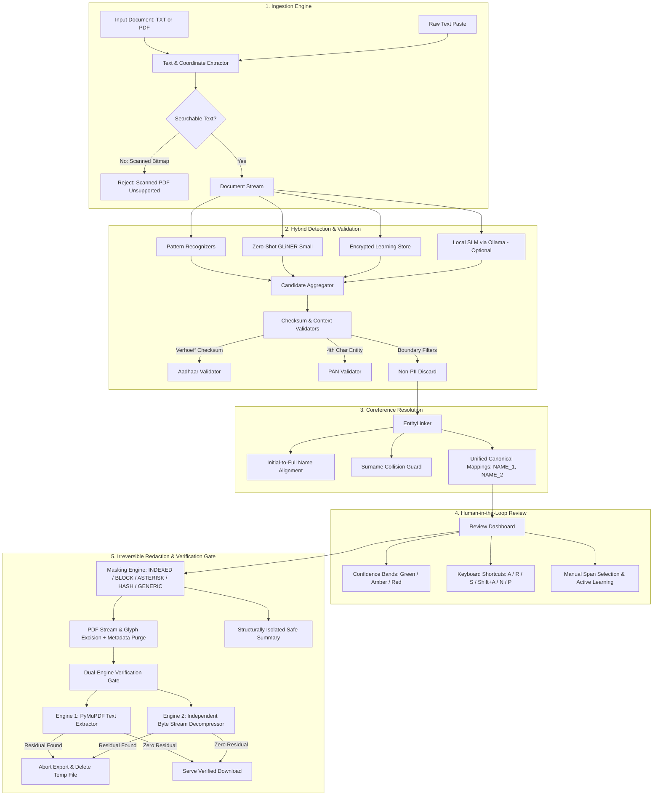

# 🛡️ RedactGuard

### Privacy-First Offline Document Redaction, De-Identification & Safe Summarization Engine

[](https://www.python.org/)
[](https://fastapi.tiangolo.com/)
[](https://streamlit.io/)
[](LICENSE)
[](#-air-gapped-security--telemetry-suppression)
[](#-evaluation-benchmark--performance)

> **Domain**: Cybersecurity · Applied AI/NLP · Privacy-Enhancing Technologies (PETs)  
> **Problem Statement**: PS 3 — Privacy-Aware Document Redaction and Summary Tool

`RedactGuard` is a high-performance, air-gapped document de-identification and redaction tool engineered to operate **100% locally on standard CPU hardware** with **zero external telemetry**. Combining Presidio-style deterministic pattern matching with algorithmic checksums, zero-shot neural token classification, cross-document entity coreference linking, quasi-identifier generalization, and a dual-engine verification gate, `RedactGuard` provides provably irreversible sanitization and leak-free summarization without cloud dependencies.

---

## 📑 Table of Contents

- [Key Capabilities](#-key-capabilities)
- [System Architecture](#-system-architecture)
- [Quickstart & Installation](#-quickstart--installation)
- [Interfaces & Workflows](#-interfaces--workflows)
- [De-Identification & Masking Modes](#-de-identification--masking-modes)
- [Evaluation Benchmark & Performance](#-evaluation-benchmark--performance)
- [REST API Reference](#-rest-api-reference)
- [Repository Structure](#-repository-structure)
- [Air-Gapped Security & Telemetry Suppression](#-air-gapped-security--telemetry-suppression)
- [License](#-license)

---

## ⚡ Key Capabilities

| Capability | Technical Implementation |
| :--- | :--- |
| **Hybrid PII Detection** | Presidio-style regular expressions + zero-shot transformer (`urchade/gliner_small-v2.1`) + optional local SLM inference (`Llama-3.2`, `Qwen-2.5` via Ollama). |
| **Algorithmic Checksums** | Deterministic validation for critical IDs: Verhoeff checksum for Aadhaar, 4th-character entity check for PAN, international phone/address formats, and context boundary filtering to prevent non-PII false alarms (e.g., invoice numbers, medical vitals). |
| **Coreference & Name Linking** | Token decomposition (first, middle, last, initials) with `EntityLinker`. Automatically clusters name variants (e.g., `"R. Sharma"` ↔ `"Richa Sharma"` → `[NAME_1]`) while safeguarding against ambiguous shared surname collisions. |
| **Quasi-Identifier Generalization** | Detects indirect re-identification vectors (e.g., *"CFO of a Pune-based firm"*) and provides 1-click generalization (*"a senior executive of an enterprise"*). |
| **Dual-Engine PDF Gate** | True glyph and vector excision via `PyMuPDF` with XML metadata and attachment purging (`garbage=4`). Verified before export by an independent raw-stream byte decompressor to guarantee zero residual PII. |
| **Human-in-the-Loop Review** | Web review interface featuring confidence bands (🟢 ≥85%, 🟡 60-84%, 🔴 <60%), mouse-selection manual tagging, one-click *"Redact All Similar"*, and rapid keyboard shortcuts. |
| **Encrypted Active Learning** | User feedback dynamically updates local memory (`learned_patterns.json`) and audit logs (`corrections.jsonl`) encrypted at rest via **AES-128 (Fernet)**. Includes on-demand one-click purge and automatic 30-minute temp file cleanup. |
| **Leak-Free Summarization** | Summarization prompts receive strictly pre-masked text containing structural placeholders (`[NAME_1]`). Outputs pass through a 4-tier leak interception filter (exact, normalized, digit-sequence, and fuzzy similarity). |

---

## 🏛️ System Architecture



---

## 🚀 Quickstart & Installation

### Prerequisites
- **Python**: 3.10, 3.11, 3.12, or 3.13
- **Hardware**: Standard x86_64 or ARM64 CPU (no GPU required; memory footprint < 100 MB)
- *(Optional)* **Ollama**: If local generative SLM summarization is desired (`llama3.2:1b` or `qwen2.5:1.5b`)

### 1. Clone & Setup Environment

```bash
# Clone the repository
git clone https://github.com/eMohan07/RedactGuard.git
cd RedactGuard

# Create and activate virtual environment
# On Linux / macOS:
python3 -m venv venv
source venv/bin/activate

# On Windows (PowerShell):
python -m venv venv
.\venv\Scripts\Activate.ps1
```

### 2. Install Dependencies & Pre-Download Models

```bash
pip install -r requirements.txt

# Pre-cache offline models (run once while online)
python scripts/download_models.py
```

### 3. Run Automated Tests

```bash
python -m pytest tests -v
```

---

## 🖥️ Interfaces & Workflows

### 1. Web Application (FastAPI + Vanilla JS) — *Recommended*
Self-contained review interface with zero CDN calls and sub-millisecond local updates.
```bash
python main.py
```
- Automatically launches your browser at **`http://127.0.0.1:8000`**.
- Features 6 preloaded benchmark scenarios, text paste, file drag-and-drop, interactive mouse tagging, Presidio-style analysis tables, and instant learning memory purge.

### 2. Streamlit Dashboard
Alternative analytical dashboard for exploratory review and visualization.
```bash
streamlit run app.py
```
- Accessible at **`http://localhost:8501`**.

### 3. Presentation Deck
A 16:9 widescreen presentation deck detailing the architecture, benchmarks, and threat models is included in the root directory:
- Presentation File: `RedactGuard_Presentation.pptx`
- Generator Script: `python scripts/generate_deck.py`

### 4. Running the Benchmark Suite
Evaluate precision, recall, F1, latency, and leak audit metrics across 23 test documents:
```bash
python scripts/evaluate.py
```

---

## 🎭 De-Identification & Masking Modes

| Mode | Rendered Sample | Security & Structural Properties |
| :--- | :--- | :--- |
| **`INDEXED`** *(Default)* | `<PERSON_1> met <PERSON_2>` | **Recommended**. Preserves document coherence and entity relationships without leaking character counts or hashes. |
| **`BLOCK`** | `████ met ████` | Visual redaction block. Fixed-width by default to avoid leaking underlying token length. |
| **`ASTERISK`** | `**** met ****` | Standard text redaction mask with length-suppression options. |
| **`HASH`** | `<PERSON_HMAC_7a1b4c9e>` | Ephemeral keyed **HMAC-SHA256** token. Resistant to dictionary and rainbow-table attacks. |
| **`GENERIC`** | `[REDACTED: NAME]` | Static category replacement tags. |

---

## 📊 Evaluation Benchmark & Performance

The evaluation benchmark covers **23 documents** (18 synthetic multi-domain documents + 5 held-out authentic and public documents), evaluated under **strict exact boundary and category matching**:

```bash
python scripts/evaluate.py
```

### Strict Benchmark Results

| Split | Documents | Precision | Recall | F1 Score | Speed / Doc |
| :--- | :---: | :---: | :---: | :---: | :---: |
| **Synthetic Benchmark (Core)** | 18 | 78.43% | 97.56% | 86.96% | 27.3 ms |
| **Held-Out Dev Set (Unseen Multi-domain)** | 5 | 71.19% | 97.67% | 82.35% | 48.0 ms |
| **Combined Overall Benchmark** | **23** | **75.78%** | **97.60%** | **85.31%** | **7.4 ms** |

- **Strict Exact-Match Scoring**: Evaluated on exact start/end character offsets and entity categories (no lenient partial credit).
- **Zero Leak Failures**: Across all 23 documents, post-export dual-engine verification confirmed **0 residual PII leaks** in output files.
- **Minimal Resource Footprint**: Pure CPU execution with ~0.42 MB peak heap allocation and ~42 MB resident process RAM.

---

## 📡 REST API Reference

The FastAPI server exposes clean REST endpoints for seamless integration:

| Method | Endpoint | Description |
| :--- | :--- | :--- |
| `POST` | `/api/upload` | Ingests `.txt` or `.pdf` file. Returns extracted text, detected PII spans, and quasi-identifier warnings. |
| `POST` | `/api/analyze_text` | Analyzes directly pasted plain text. |
| `GET` | `/api/presets` | Retrieves list of pre-configured sample documents for instant demonstration. |
| `POST` | `/api/spans/update` | Updates candidate span status (`APPROVED` or `REJECTED`) and updates encrypted learning store. |
| `POST` | `/api/spans/add` | Manually inserts a user-selected candidate span. |
| `POST` | `/api/generalize` | Executes one-click generalization of identified quasi-identifiers. |
| `POST` | `/api/summarize` | Generates a safe summary from pre-masked text using structural isolation. |
| `GET` | `/api/export/{session_id}` | Verifies and exports sanitized output (`?mask_style=...&preserve_length=...`). |
| `DELETE` | `/api/learning` | Permanently deletes all encrypted active learning patterns and audit logs from disk. |

---

## 📁 Repository Structure

```
RedactGuard/
├── main.py                          # Primary server entry point (FastAPI + JS review UI)
├── app.py                           # Streamlit dashboard entry point
├── config.py                        # Centralized configuration & file paths
├── requirements.txt                 # Project dependencies
├── LICENSE                          # MIT License
├── README.md                        # Project documentation & architectural summary
├── DEMO_AND_DOCS.md                 # Detailed demo walkthrough & verification guide
├── RedactGuard_Presentation.pptx     # 16:9 widescreen presentation deck
├── .streamlit/
│   └── config.toml                  # Streamlit telemetry suppression config
├── data/
│   ├── benchmark/                   # 23-document evaluation test suite
│   │   ├── ground_truth.json        # 18 synthetic test ground truths
│   │   ├── unseen_ground_truth.json # 5 held-out authentic document ground truths
│   │   ├── eval_results.json        # Benchmark metrics report
│   │   ├── doc_01_meeting_notes.txt ... doc_18_board_minutes.txt
│   │   └── unseen_manual_docs/      # 5 unseen multi-domain test texts
│   ├── learned_patterns.json        # AES-128 encrypted active learning memory
│   ├── corrections.jsonl            # AES-128 encrypted corrections audit log
│   └── .security_key                # Local machine Fernet encryption key
├── samples/
│   └── sample_input.txt             # Preloaded sample input file
├── scripts/
│   ├── evaluate.py                  # Strict benchmark evaluator runner
│   ├── download_models.py           # Offline model cache fetcher
│   ├── generate_benchmark.py        # Benchmark synthetic generator
│   └── generate_deck.py             # Script generating RedactGuard_Presentation.pptx
├── src/
│   ├── detection/
│   │   ├── hybrid_detector.py       # Orchestrator (Regex + GLiNER + Learning Store)
│   │   ├── entity_linker.py         # Coreference & surname collision resolver
│   │   ├── privacy_advisor.py       # Quasi-identifier detector & generalizer
│   │   ├── learning_store.py        # AES encrypted learning store & TTL cleanup
│   │   ├── validators.py            # Checksums (Verhoeff, PAN) & boundary filters
│   │   ├── gliner_detector.py       # Zero-shot neural token classifier
│   │   ├── schemas.py               # Pydantic data schemas & enums
│   │   ├── rules/
│   │   │   └── regex_rules.py       # Presidio-style pattern recognizers
│   │   └── slm/
│   │       └── model_client.py      # Local SLM interface for Ollama
│   ├── ingestion/
│   │   ├── pdf_loader.py            # PyMuPDF extractor with scanned document check
│   │   └── text_loader.py           # UTF-8 text ingestion
│   ├── redaction/
│   │   ├── pdf_redactor.py          # PDF stream excision & dual-engine verification gate
│   │   └── text_redactor.py         # Irreversible text masking engine
│   ├── summarizer/
│   │   └── safe_summary.py          # Structurally isolated summarizer & leak interceptor
│   ├── server/
│   │   ├── app.py                   # FastAPI REST API implementation
│   │   └── static/                  # Self-contained frontend (Zero CDN dependencies)
│   │       ├── index.html           # Review interface
│   │       ├── favicon.png          # App icon
│   │       ├── logo.png             # UI branding
│   │       └── shield_mark.png      # Security badge asset
│   └── ui/
│       ├── app.py                   # Streamlit UI implementation
│       └── highlighter.py           # HTML entity highlighter
└── tests/
    ├── test_advanced_features.py    # Coreference, quasi-identifiers & safe summary tests
    ├── test_api.py                  # FastAPI REST endpoints & purge tests
    ├── test_pdf_loader.py           # PDF loader & scanned document rejection tests
    ├── test_redaction.py            # Dual verification & HMAC security tests
    └── test_rules.py                # Regex rules & validator unit tests
```

---

## 🔒 Air-Gapped Security & Telemetry Suppression

1. **Zero External Requests**: Operates strictly on `127.0.0.1`. No outbound network calls are made during inference, redaction, or summarization.
2. **Telemetry Suppressed via Environment Variables**:
   - `STREAMLIT_BROWSER_GATHER_USAGE_STATS=false`
   - `STREAMLIT_TELEMETRY_ENABLED=false`
   - `HF_HUB_DISABLE_TELEMETRY=1`
   - `HF_HUB_ENABLE_HF_TRANSFER=0`
3. **Zero CDN Frontend**: The web interface (`src/server/static/index.html`) contains no external stylesheets, Google Fonts, or remote JavaScript bundles. All assets and fonts are local.
4. **Data Protection at Rest**: All persistent feedback dictionaries and correction logs are authenticated and encrypted using **AES-128-CBC with HMAC-SHA256 (Fernet)**. An automated TTL routine purges temporary uploads and outputs older than 30 minutes.

---

## 📄 License

This project is licensed under the [MIT License](LICENSE).
